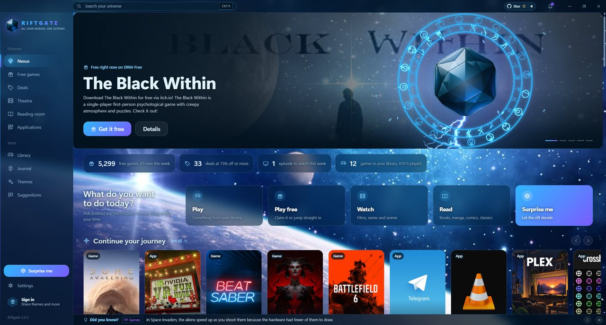
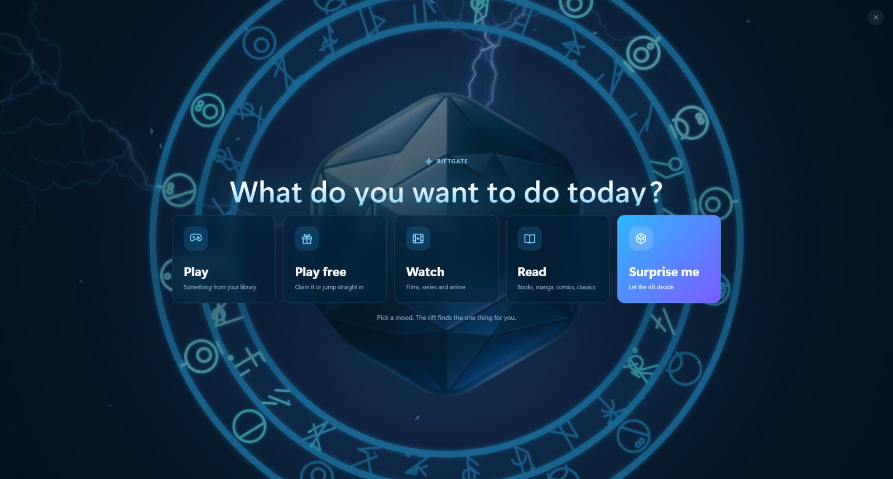
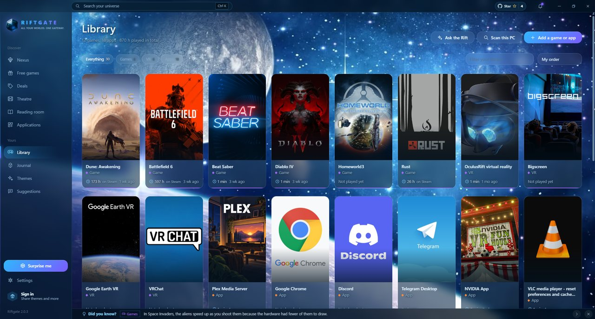
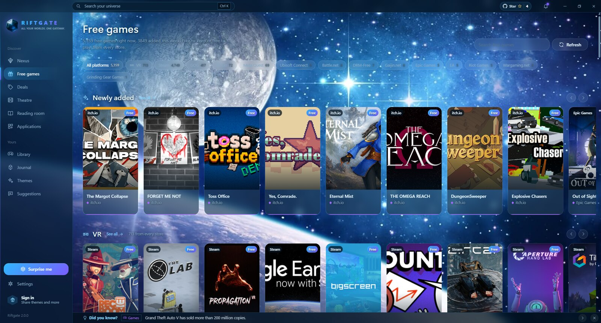
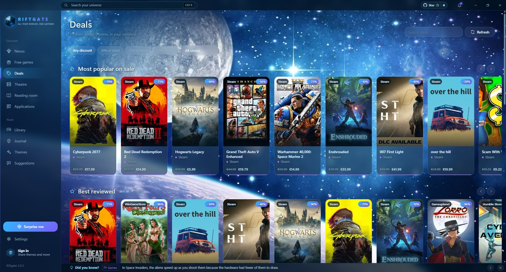
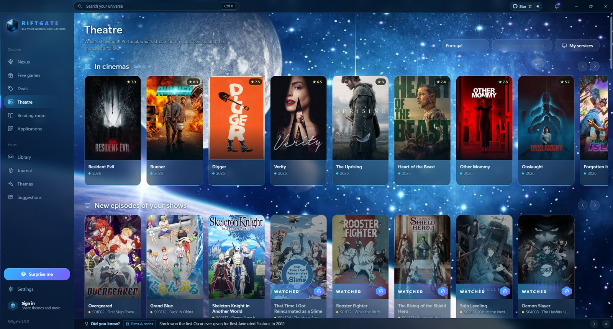
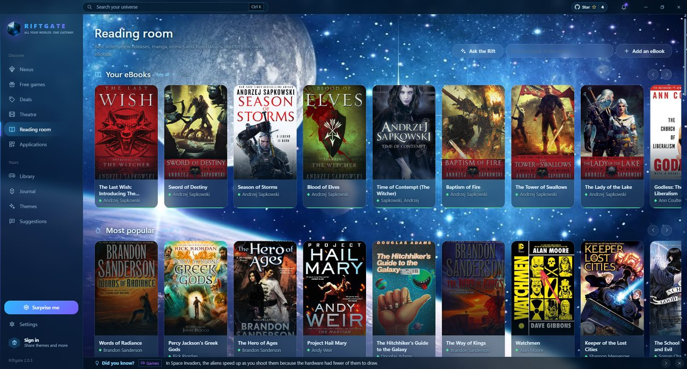
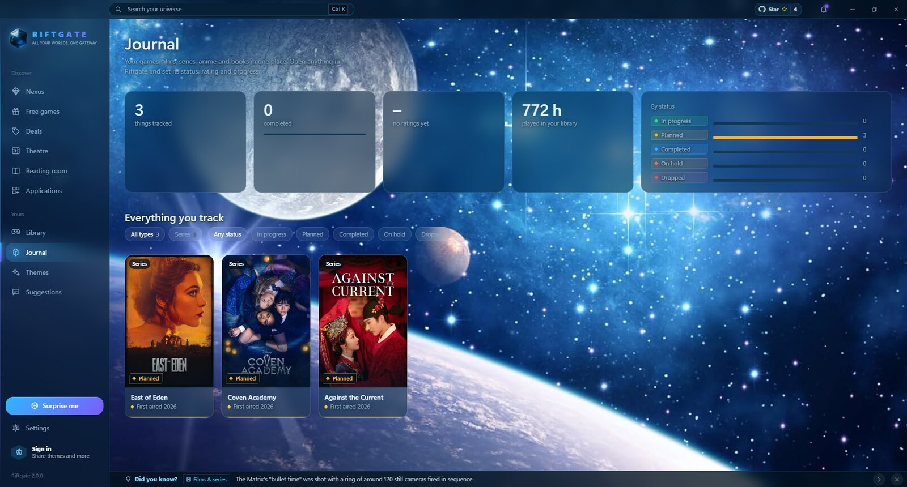
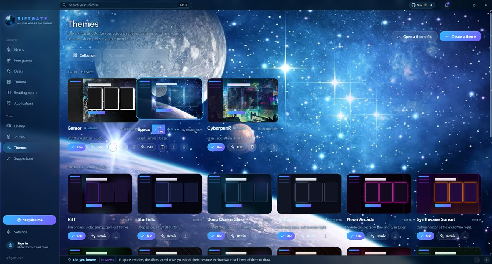

# Riftgate

**All your worlds. One gateway.**

Riftgate is a free entertainment hub for Windows and Mac. Your games,
films, series, anime, books, apps, free games and deals live together in
one desktop app. Instead of jumping between launchers, store pages,
streaming sites and release calendars, you open one window and everything
is there, up to date and in your region.

**Riftgate 2.0 is rebuilt from the ground up.** It has a new look, a home
page that shows what matters right now and a Journal for everything you
play, watch and read. You can make your own themes, and Surprise me picks
the one thing worth your evening. It installs over your current Riftgate
and keeps your library, shows, books and settings.

**New:** Riftgate tells you the moment a game goes free and reminds you
before it ends, watches your wishlist for price drops, shows what changed
while you were away, and grows with you: everything you finish becomes a
relic orbiting your rift, Seals mark what you achieve, and every December
Rift Rewind looks back on your year. ([Watch the opening](docs/riftgate-opening.mp4))

---

## Download

### 👉 [Download the latest version](https://github.com/Raidex81/Riftgate/releases/latest)

It's free. On that page, open **Assets** and pick the file for your
computer:

| Computer | File |
|---|---|
| Windows 10/11 | `Riftgate-Setup-<version>.exe` |
| Mac with Apple chip (M1 or newer) | `Riftgate-<version>-arm64.dmg` |
| Mac with Intel chip | `Riftgate-<version>.dmg` |

> **Already using Riftgate on Windows?** You don't need to download
> anything: Riftgate offers you 2.0 by itself, asks before installing, and
> keeps all your data.
>
> **Windows first install:** Windows may show a blue "Windows protected
> your PC" screen the first time you run the installer. Riftgate isn't
> digitally signed yet, and Windows shows this screen for unsigned apps
> from independent developers. Click **More info → Run anyway**. It only
> happens once, because later updates install through the app itself.
>
> **Mac first install:** open the `.dmg`, drag Riftgate into
> Applications, then **right-click → Open** the first time (or go to
> System Settings → Privacy & Security → **Open Anyway**). If macOS says
> the app "is damaged", run `xattr -cr /Applications/Riftgate.app` in
> Terminal and open it again. The Mac version isn't signed yet, so it
> can't update itself: download the new `.dmg` for each new version. Your
> library and settings are kept.

You don't need an account: everything works the moment it opens. Signing
in is only for extras like sharing themes and sending suggestions.

---

## What's inside

**💠 Nexus** is the home page and shows what matters right now: what's
free to keep this week, what's in cinemas near you and new episodes of
your shows. It also has the best deals, new series and anime, and what
you were in the middle of. Tell Riftgate what you're into (games, free
games, deals, films and series, anime, books) and it leads with that.
Anything you mark "Not for me" leaves the menu.

**🎲 Surprise me** asks what you're in the mood for: play, play free,
watch, read, or let the rift decide. Narrow it down if you like, and
Riftgate picks the one thing, skipping what you've already finished.

**✨ Ask the Rift** lets you say it in your own words: "a co-op shooter
for friends, no horror", "something funny and short", "a cosy fantasy
book", "a game like Team Fortress 2". It picks three from Riftgate's own
lists, ranked by real reviews and ratings, and tells you why. It's in
Surprise me and in Free games, the Theatre, the Reading room and the
Library, and it runs on your computer: free, and nothing you type leaves
Riftgate.

**📀 Library** keeps every game, app and VR title you run on one shelf.
To add something, drop a shortcut or `.exe` anywhere on Riftgate, or let
it find your Steam games and installed apps. Riftgate notices what you
install or uninstall later and asks before changing anything. Steam games
show your real Steam hours. You can sort the shelf any way you like, or
drag it into your own order.

**🎁 Free games** collects thousands of games that are free to keep or
free to play right now. **Riftgate tells you the moment a game goes free to
keep, and reminds you on its last day if you haven't claimed it**: the
giveaways running today come first, with how long each one lasts. The sources include Steam, Epic Games, every free
game on GOG, itch.io, giveaway trackers and the big free-to-play titles.
You get a VR view (native and adapted), genres, popularity and a row for
everything new this week.

**🏷️ Deals** shows the biggest current discounts on PC games from Steam
and dozens of other stores, with review scores and trailers. Prices
follow your region's currency. Put a game on your **wishlist** and
Riftgate tells you when its price drops.

**🎬 Theatre** covers what's in cinemas near you (pick your cinema for
sessions and tickets) and what's coming soon. It shows what's popular on
each streaming service in your country, plus new series and anime with
where they stream. Your own shows get a countdown to the next episode.

**📚 Reading room** has best sellers, new releases, free classics, manga
and comics, plus your own EPUB/PDF library. Drop a book anywhere on
Riftgate to add it. Books you've read get an "Already read" seal
everywhere.

**📓 Journal** tracks anything, whether it's a game, film, series,
anime or book. Mark it as playing, watching, reading, planned, completed,
on hold or dropped, then rate it with gems, follow your progress and keep
a note. Every card in Riftgate shows its status. **Everything you finish
becomes a relic orbiting your rift** on Nexus, **Seals** mark what you
achieve across every world (a few are secret), and **Rift Rewind** looks
back on your year every December, with a card of your rift to share.

**🎨 Themes** gives you 20 built-in looks, plus a studio for your own:
colours, light or dark, glass, soft, neon, brutal or rounded surfaces,
patterns, fonts and your own picture as the background. "Match the theme to
my picture" builds a theme from the picture's colours. You can share a theme
with everyone or try the ones other people made.

**🧩 Applications** lists apps built by the community, each with a credit
for its creator. Made one yourself? Put it forward from inside the app.

**And also:**

- **Search everything** (Ctrl K): games, films, series, books and every
  command, from anywhere.
- **Every card opens its details**, with the trailer, where to watch or
  buy, and your Journal.
- **Controller & TV mode**: play from the couch with an Xbox,
  PlayStation or Nintendo controller or a TV remote. The full button
  list is in [CONTROLS.md](CONTROLS.md), and View / Share / F1 shows it
  inside the app.
- **Make it fit**: you can choose the card size, colour cards by kind
  (games, films, series, anime, books, apps) and drag sections and rows
  into your own order.
- **Did you know?** shows a fact from the world you're in along the
  bottom, and a short tour introduces Riftgate on your first start.
- **While you were away**: come back after a while and the rift shows
  what changed: new free games, the ones about to end, new episodes of
  your shows, price drops on your wishlist.
- **Seasonal events**: Riftgate changes with the year for a few days at a
  time, then goes back to your theme by itself. First up: the Hallowed
  Rift, 22 October to 3 November.
- **Private by design**: your library, Journal and everything you do stay
  on your PC, and Ask the Rift runs there too. The only thing Riftgate can
  send is an anonymous weekly "this PC used Riftgate", and only if you say
  yes to it.
- **Mature titles** show only to adults who turn them on, based on the
  date of birth on their Riftgate account.
- **Updates itself** on Windows, and always asks first.

---

## Contact

Questions, suggestions, or an app you'd like listed in Applications?
Email the Riftgate team at
**[riftgateappdev@zohomail.eu](mailto:riftgateappdev@zohomail.eu)**. Bugs
and feature ideas are also welcome as
[GitHub issues](https://github.com/Raidex81/Riftgate/issues), or from
**Suggestions** inside the app.

## For developers

Riftgate is open source under the [GNU GPL v3.0 or later](LICENSE), and
contributions are welcome: bug reports, ideas, fixes and new features.
Read **[CONTRIBUTING.md](CONTRIBUTING.md)** to get started. Running it
from source is just `npm install` and `npm start`, with no API keys
needed.

It's built with [Electron](https://www.electronjs.org/) for Windows and
macOS from one shared codebase. The interface is plain JavaScript modules
and CSS, with no framework and no build step.
[Supabase](https://supabase.com/) holds the shared data: accounts,
suggestions, Applications, shared themes and the Vault. Third-party media
APIs (TMDB, RAWG, SteamGridDB, YouTube) are proxied server-side, so no
vendor keys ship inside the app. The cinema list comes from
[OpenStreetMap](https://www.openstreetmap.org/copyright) (© OpenStreetMap
contributors).

For how it all fits together (the process model, IPC and security, what's
stored where, data sources, and the build and release pipeline), see
**[ARCHITECTURE.md](ARCHITECTURE.md)**. Riftgate 1.x stays available on
the [`v1` branch](https://github.com/Raidex81/Riftgate/tree/v1).
